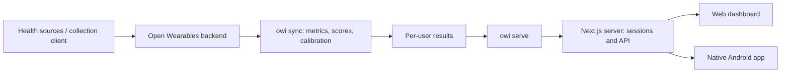

<p align="right"><strong>English</strong> · <a href="README.sk.md">Slovenčina</a></p>

# Zdravie

**Wearable data, understandable trends, and calculations you can inspect.**

Zdravie is an open-source project combining a self-hosted processing service, a web dashboard, and a native Android app. It builds on [Open Wearables](https://github.com/the-momentum/open-wearables) to turn collected measurements into daily activity, sleep, recovery, and training views.

This repository contains all three Zdravie components. Open Wearables and its data-collection client are separate projects.

[How it works](#how-it-works) · [Android](#android-app) · [Self-hosting](#run-your-own-instance) · [Development](#development) · [Documentation](#documentation) · [MIT license](LICENSE)

## What you can do

- See daily measurements, sleep, workouts, and longer-term trends on the web.
- Use native Android screens for your overview, 14/30-day history, and day/workout details.
- Inspect documented score formulas and distinguish measurements from estimates marked `≈`.
- Calibrate estimates against Samsung Health reference values, with separate data and settings for each paired account.
- Operate the raw-data backend and processing on your own infrastructure, while choosing where to host the web service.

**Current stage:** an early, working project. Samsung Health is the primary real-data integration used so far. Apple Health and Suunto handling is covered by synthetic tests; real-device validation is still pending. The web and Android interface are currently in Slovak. The README is available in English and Slovak.

## How it works



| Component | Responsibility | Source |
|---|---|---|
| Open Wearables | Collect and store source measurements; connect devices and providers | [Upstream project](https://github.com/the-momentum/open-wearables) |
| `owi` | Group data into local days, handle overlapping sources, compute metrics/scores, and calibrate estimates | [`src/owi/`](src/owi/) |
| Python HTTP API | Serve account-specific results; handle accounts and reference entries using separate server credentials | [`src/owi/serve.py`](src/owi/serve.py) |
| Next.js web | Authenticate sessions, request authorized data, and render the web dashboard | [`web/`](web/) |
| Native Android | Sign in, fetch authorized results, and display native screens and charts | [`android/`](android/) |

The **server performs the health-data calculations**. Android formats and visualizes the results, manages its local session, and handles navigation; it does not retrain scores or run the processing pipeline. The current Zdravie Android app does **not** collect Health Connect data itself. Collection continues through the existing Open Wearables client.

A formula change reaches web and Android users after deploying the processing service and recomputing the relevant results. A native-screen change requires a new signed APK. Web deployment, backend deployment, and Android installation are separate steps.

## Android app

The Kotlin/Jetpack Compose app supports **Android 8.0 / API 26 and later**. It includes sign-in, pending-account status, overview, history charts, day/workout details, light/dark themes, and sign-out. Registration, password recovery, and profile management open the web service in a browser.

Use the same Zdravie account as on the web. An administrator pairs new accounts with an Open Wearables identity before their data becomes available. There is no shared dashboard password.

### Install and update

Get the [latest Android release](https://github.com/Richinino/Open-Wearables-Integrations/releases/latest) from GitHub, without Google Play. Starting with **v0.1.1**, the app checks for a newer release and offers to download it or postpone the prompt. After the download is verified, choose **Inštalovať** and confirm Android's installation dialog. The first time, Android may ask you to allow installations from Zdravie. Routine updates install over the existing app without uninstalling it.

If you have the original **v0.1.0 debug APK**, install the updater-enabled APK over it once. That older build cannot discover updates itself. The package and signing certificate must match for an in-place update.

CI builds and versions new releases automatically when Android sources change on the configured production branch. See the [release and update guide](docs/mobile/android-releases.md) for assets, verification, signing, and publishing. For local builds and session-storage details, use the [Android guide](android/README.md). A self-hosted fork must configure its Android build to use its own HTTPS API origin and release repository.

Not included yet: Health Connect collection in Zdravie, offline history, widgets, and notifications.

## Measurements, estimates, and missing data

| Data | Handling |
|---|---|
| Steps | Prefer the source's daily count; otherwise use available hourly/phone data |
| Heart rate and sleep | Derive daily views from measurements; select sleep without double-counting overlapping sources |
| Distance and calories | Prefer source measurements where available; otherwise use an identified estimate |
| Active time | Estimate from workouts and heart-rate thresholds |
| Recovery, sleep, activity, and training scores | Compute on the server from documented inputs, history requirements, and approximations |

Missing data stays missing instead of becoming zero. Some scores need sufficient personal history and remain unavailable until that requirement is met. Reference entries can tune selected estimates and Samsung-inspired score models; they do not make those models identical to a manufacturer's proprietary algorithm.

The [score reference](docs/skore.md) records formulas, sources, assumptions, and confidence limits. These are experimental wellness metrics, not clinically validated measurements. The project is independent of Samsung, WHOOP, Oura, Apple, Polar, and other manufacturers mentioned in the references.

## Run your own instance

This is a multi-service setup. A clone contains application source, **not accounts, credentials, collected health data, or a configured Open Wearables installation**.

1. Set up [Open Wearables](https://github.com/the-momentum/open-wearables) and a compatible collection/provider connection.
2. Configure processing using [`.env.example`](.env.example): API connection, timezone, required profile values, and separate read/write tokens.
3. Start `owi`, complete the account/bootstrap procedure, and verify the local API.
4. Configure Next.js using [`web/.env.example`](web/.env.example), then connect the Android build to that HTTPS origin.

Start with the [accounts and migration guide](docs/ucty-prevadzka.md), then the [operations guide](docs/prevadzka.md). These detailed guides are currently in Slovak. The operations notes describe the existing Windows/Docker/Tailscale deployment; some older single-user notes are historical, so use the accounts guide for current authentication and data layout.

For a configured development environment with Python 3.12+ and [`uv`](https://docs.astral.sh/uv/):

```bash
cp .env.example .env
# Fill in your own local configuration before continuing.
uv sync --locked
uv run owi sync
uv run owi serve
```

The API binds to `127.0.0.1:8787` by default. Docker runs periodic computation and the API as separate services:

```bash
docker compose --env-file .env -f docker/compose.yml up -d --build
```

Compose expects an existing Open Wearables Docker network, by default `open-wearables_default`. Network name and upstream API URL are configurable. HTTPS publication through Tailscale Funnel is part of the reference deployment, not a requirement for the calculation engine.

Useful processing commands:

```bash
uv run owi sync --from 2026-10-01 --to 2026-10-14
uv run owi day 2026-10-14 --json
uv run owi rescore          # Recompute scores from stored features; no raw-data download.
uv run owi calibrate        # Fit estimates against available reference entries.
uv run owi check            # Compare estimates with reference entries.
```

In account mode, commands select the configured owner's active paired account by default. Use `--account <account-id>` to select another account explicitly. Existing installations need the documented migration before enabling account mode.

## Data and accounts

Raw measurements remain in the configured Open Wearables backend. This service keeps computed history in `data/users/<ow_user_id>/`, account records in `data/accounts/`, and reference entries in `data/zapisy/<ow_user_id>/`. The web server and phone receive the authorized results, so their hosting and access are also part of your deployment.

Shared backend tokens stay on servers. Android does not save the password or health history to disk; an optionally remembered session is encrypted using Android Keystore and excluded from backups. Sign-out clears the session and loaded data. Account status and session versions are checked on the server.

Keep `.env` files, databases, keys, health records, and backup archives out of Git. The repository ignores local data and secrets. A source checkout is not a backup of an installation; use the documented [backup and restore procedure](docs/prevadzka.md).

## Development

| Directory | Contents |
|---|---|
| [`src/owi/`](src/owi/) | Python processing, persistence, accounts, CLI, and HTTP API |
| [`tests/`](tests/) | Python regression tests and synthetic data factories |
| [`web/`](web/) | Next.js dashboard and server routes |
| [`android/`](android/) | Kotlin/Compose app, Gradle build, and Android tests |
| [`docker/`](docker/) | Processing/API images and Compose configuration |
| [`scripts/`](scripts/) | Deployment, backup, and Funnel diagnostics |
| [`docs/`](docs/) | Score references, operations, contracts, and design history |

Python:

```bash
uv sync --locked
uv run ruff check .
uv run ruff format --check .
uv run pytest -q
```

Web, using Node.js 24:

```bash
cd web
npm ci
# Configure .env.local from .env.example; account login requires the backend.
npm run dev -- -p 3100
```

For web checks, run `npm run lint`, `npm test`, `npx next typegen`, `npx tsc --noEmit`, and `npm run build` from `web/`. Synthetic data helpers are for non-production development and do not bypass account authentication.

Android, using JDK 21 and the Android SDK:

```bash
bash android/gradlew -p android :app:assembleDebug :app:testDebugUnitTest :app:lintDebug
```

On Windows, use `android/gradlew.bat` instead of `bash android/gradlew`. Emulator/device checks use `:app:connectedDebugAndroidTest`; see the [Android guide](android/README.md). CI runs Python, web, Android build/unit/lint, and Windows watchdog checks. Tests use synthetic fixtures; passing them does not imply validation on every supported physical device.

For contributions, describe the behavior being changed, include a reproducible case using synthetic data, and run the relevant checks. Keep measured/estimated provenance and account isolation intact. Never attach real health records, passwords, or session tokens to public issues.

## Documentation

The README is bilingual; most detailed references currently remain in Slovak.

| Guide | Contents |
|---|---|
| [Android](android/README.md) | Build, scope, local storage, and device checks |
| [Android releases](docs/mobile/android-releases.md) | APK distribution, signing, update checks, and publishing |
| [Android verification](docs/mobile/android-v1-verification.md) | Dated v0.1.0 test evidence and remaining limits |
| [Mobile API contract](docs/mobile/android-v1-contract.md) | Authentication, identity checks, and client/server interface |
| [Accounts](docs/ucty-prevadzka.md) | Bootstrap, pairing, migration, password recovery, and administration |
| [Score reference](docs/skore.md) | Formulas, supporting sources, and approximations |
| [Operations](docs/prevadzka.md) | Deployment, backups, recovery, and moving to another host |
| [Processing overview](docs/ako-to-funguje.md) | Background on data selection and the original deployment |
| [Audit](docs/audit-2026-10-19.md) | Dated findings and follow-up history |

## Credits and licensing

Zdravie uses [Open Wearables](https://github.com/the-momentum/open-wearables) as its collection/storage foundation. Upstream projects and third-party dependencies retain their own licenses and attribution requirements.

Zdravie is available under the [MIT license](LICENSE).
