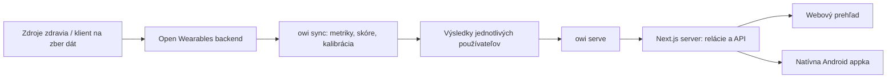

<p align="right"><a href="README.md">English</a> · <strong>Slovenčina</strong></p>

# Zdravie

**Dáta z hodiniek, zrozumiteľné trendy a výpočty, do ktorých vidíš.**

Zdravie je open-source projekt, ktorý spája výpočtovú službu na vlastnom serveri, webový prehľad a natívnu Android appku. Využíva [Open Wearables](https://github.com/the-momentum/open-wearables) a zo zozbieraných meraní vytvára denné prehľady aktivity, spánku, regenerácie a tréningov.

Tento repozitár obsahuje všetky tri časti Zdravie. Open Wearables a jeho klient na zber dát sú samostatné projekty.

[Ako to funguje](#ako-to-funguje) · [Android](#android-appka) · [Vlastná inštancia](#spustenie-vlastnej-inštancie) · [Vývoj](#vývoj) · [Dokumentácia](#dokumentácia) · [Licencia MIT](LICENSE)

## Čo projekt umožňuje

- Prezerať denné merania, spánok, tréningy a dlhodobejšie trendy na webe.
- Používať natívne Android obrazovky s prehľadom, históriou za 14/30 dní a detailom dňa či tréningu.
- Pozrieť si zdokumentované vzorce skóre a odlíšiť merania od odhadov označených `≈`.
- Dolaďovať odhady podľa referenčných hodnôt zo Samsung Health, s oddelenými dátami a nastaveniami spárovaných účtov.
- Prevádzkovať úložisko surových dát a výpočty na vlastnej infraštruktúre a zvoliť si hosting webovej služby.

**Aktuálny stav:** funkčný projekt v ranej fáze. Samsung Health je hlavné napojenie doteraz používané so skutočnými dátami. Spracovanie Apple Health a Suunto pokrývajú syntetické testy; overenie so skutočnými zariadeniami ešte nasleduje. Web aj Android rozhranie sú zatiaľ po slovensky. README je dostupné po anglicky a slovensky.

## Ako to funguje



| Časť | Zodpovednosť | Zdroj |
|---|---|---|
| Open Wearables | Zbiera a ukladá vstupné merania; pripája zariadenia a poskytovateľov | [Pôvodný projekt](https://github.com/the-momentum/open-wearables) |
| `owi` | Rozdeľuje dáta na lokálne dni, rieši prekrývajúce sa zdroje, počíta metriky/skóre a dolaďuje odhady | [`src/owi/`](src/owi/) |
| Python HTTP API | Poskytuje výsledky jednotlivých účtov; obsluhuje účty a referenčné zápisy cez oddelené serverové oprávnenia | [`src/owi/serve.py`](src/owi/serve.py) |
| Next.js web | Overuje relácie, žiada povolené dáta a zobrazuje webový prehľad | [`web/`](web/) |
| Natívny Android | Prihlasuje používateľa, načítava jeho výsledky a zobrazuje natívne obrazovky a grafy | [`android/`](android/) |

**Zdravotné metriky a skóre počíta server.** Android výsledky formátuje a vizualizuje, spravuje svoju lokálnu reláciu a navigáciu; nepreškoľuje skóre ani nespúšťa výpočtový proces. Aktuálna Android appka Zdravie sama **nezbiera dáta z Health Connect**. Zber naďalej zabezpečuje existujúci klient Open Wearables.

Zmena vzorca sa prejaví na webe aj v Androide po nasadení výpočtovej služby a prepočítaní príslušných výsledkov. Zmena natívnych obrazoviek potrebuje nové podpísané APK. Nasadenie webu, nasadenie backendu a inštalácia Androidu sú samostatné kroky.

## Android appka

Appka v Kotline a Jetpack Compose podporuje **Android 8.0 / API 26 a novší**. Obsahuje prihlásenie, stav čakajúceho účtu, prehľad, grafy histórie, detail dňa a tréningov, svetlú/tmavú tému a odhlásenie. Registrácia, obnova hesla a správa profilu otvárajú webovú službu v prehliadači.

Používa sa rovnaký účet Zdravie ako na webe. Nové účty administrátor spáruje s identitou Open Wearables, až potom získajú prístup k svojim dátam. Spoločné heslo pre celý prehľad sa nepoužíva.

### Inštalácia a aktualizácie

Stiahni si [najnovšie Android vydanie](https://github.com/Richinino/Open-Wearables-Integrations/releases/latest) z GitHubu, bez Google Play. Od **v0.1.1** appka kontroluje novšie vydanie a ponúkne stiahnutie alebo odloženie výzvy. Po overení stiahnutého súboru zvoľ **Inštalovať** a potvrď inštalačný dialóg Androidu. Pri prvom použití môže Android požiadať o povolenie inštalácií zo Zdravie. Bežná aktualizácia sa nainštaluje cez existujúcu appku bez odinštalovania.

Ak máš pôvodné **vývojové APK v0.1.0**, raz cezň nainštaluj APK s podporou aktualizácií. Staré zostavenie ich samo nevyhľadá. Na aktualizáciu cez existujúcu appku sa musí zhodovať balíček a podpisový certifikát.

CI automaticky zostavuje a čísluje nové vydania pri zmenách Android zdrojov v nakonfigurovanej produkčnej vetve. [Príručka vydávania a aktualizácií](docs/mobile/android-releases.md) popisuje súbory vydania, overovanie, podpisovanie a publikovanie. Lokálne zostavenie a uloženie relácie nájdeš v [Android príručke](android/README.md). Pri vlastnej inštancii treba Android zostavenie nastaviť na vlastnú HTTPS adresu API a vlastný repozitár vydaní.

Zatiaľ nie sú zahrnuté: zber cez Health Connect priamo v Zdravie, offline história, widgety a upozornenia.

## Merania, odhady a chýbajúce dáta

| Údaj | Spracovanie |
|---|---|
| Kroky | Prednosť má denný súčet zdroja; inak sa použijú dostupné hodinové/telefónne dáta |
| Tep a spánok | Denné prehľady vznikajú z meraní; spánok sa vyberá bez dvojitého započítania prekrývajúcich sa zdrojov |
| Vzdialenosť a kalórie | Prednosť majú dostupné merania zo zdroja, inak sa použije označený odhad |
| Aktívny čas | Odhad z tréningov a prahov tepu |
| Skóre regenerácie, spánku, aktivity a záťaže | Počíta server podľa zdokumentovaných vstupov, potrebnej histórie a aproximácií |

Chýbajúca hodnota zostáva chýbajúca, nemení sa na nulu. Niektoré skóre potrebujú dostatočnú osobnú históriu a dovtedy sa nezobrazia. Referenčné zápisy môžu doladiť vybrané odhady a modely skóre inšpirované Samsungom; nerobia z nich totožnú kópiu neverejného algoritmu výrobcu.

[Referenčná dokumentácia skóre](docs/skore.md) obsahuje vzorce, zdroje, predpoklady a hranice dôvery. Ide o experimentálne metriky pre osobný prehľad, nie klinicky overené merania. Projekt je nezávislý od Samsungu, WHOOP, Oura, Apple, Polar a ďalších výrobcov uvedených v zdrojoch.

## Spustenie vlastnej inštancie

Ide o systém s viacerými službami. Klon obsahuje zdrojový kód, **nie účty, prístupové údaje, zozbierané zdravotné dáta ani nakonfigurovanú inštaláciu Open Wearables**.

1. Priprav [Open Wearables](https://github.com/the-momentum/open-wearables) a kompatibilný zber dát či napojenie poskytovateľa.
2. Nakonfiguruj výpočty podľa [`.env.example`](.env.example): spojenie s API, časové pásmo, potrebné profilové údaje a samostatné tokeny na čítanie a zápis.
3. Spusť `owi`, dokonči prvotné nastavenie účtov a over lokálne API.
4. Nakonfiguruj Next.js podľa [`web/.env.example`](web/.env.example) a Android zostavenie pripoj na jeho HTTPS adresu.

Začni [príručkou účtov a migrácie](docs/ucty-prevadzka.md), potom pokračuj [prevádzkovou príručkou](docs/prevadzka.md). Podrobné príručky sú zatiaľ po slovensky. Prevádzkové poznámky opisujú existujúce nasadenie Windows/Docker/Tailscale; niektoré staršie poznámky k jednému používateľovi sú historické, preto pre aktuálne prihlasovanie a rozloženie dát použi príručku účtov.

Pre nakonfigurované vývojové prostredie s Pythonom 3.12+ a [`uv`](https://docs.astral.sh/uv/):

```bash
cp .env.example .env
# Pred pokračovaním doplň vlastnú lokálnu konfiguráciu.
uv sync --locked
uv run owi sync
uv run owi serve
```

API sa predvolene viaže na `127.0.0.1:8787`. Docker spúšťa pravidelný prepočet a API ako samostatné služby:

```bash
docker compose --env-file .env -f docker/compose.yml up -d --build
```

Compose očakáva existujúcu Docker sieť Open Wearables, predvolene `open-wearables_default`. Názov siete a adresa upstream API sa dajú nastaviť. Verejné HTTPS cez Tailscale Funnel je súčasťou referenčného nasadenia, nie podmienkou samotných výpočtov.

Užitočné príkazy:

```bash
uv run owi sync --from 2026-10-01 --to 2026-10-14
uv run owi day 2026-10-14 --json
uv run owi rescore          # Prepočet skóre z uložených znakov; bez sťahovania surových dát.
uv run owi calibrate        # Doladenie odhadov podľa dostupných referenčných zápisov.
uv run owi check            # Porovnanie odhadov s referenčnými zápismi.
```

V režime účtov príkazy predvolene vyberajú aktívny spárovaný účet nakonfigurovaného majiteľa. Iný účet vyber výslovne cez `--account <account-id>`. Existujúce inštancie potrebujú pred zapnutím režimu účtov zdokumentovanú migráciu.

## Dáta a účty

Surové merania zostávajú v nakonfigurovanom backende Open Wearables. Táto služba ukladá vypočítanú históriu do `data/users/<ow_user_id>/`, účty do `data/accounts/` a referenčné zápisy do `data/zapisy/<ow_user_id>/`. Webový server aj telefón dostávajú povolené výsledky, preto je ich hosting a prístup takisto súčasťou nasadenia.

Spoločné backendové tokeny zostávajú na serveroch. Android neukladá heslo ani zdravotnú históriu na disk; voliteľne zapamätaná relácia je šifrovaná cez Android Keystore a vylúčená zo záloh. Odhlásenie vyčistí reláciu aj načítané dáta. Stav účtu a verzie relácií overuje server.

Súbory `.env`, databázy, kľúče, zdravotné záznamy ani archívy záloh nepatria do Gitu. Repozitár lokálne dáta a tajomstvá ignoruje. Zdrojový kód nie je záloha inštalácie; použi zdokumentovaný [postup zálohy a obnovy](docs/prevadzka.md).

## Vývoj

| Priečinok | Obsah |
|---|---|
| [`src/owi/`](src/owi/) | Python výpočty, úložisko, účty, CLI a HTTP API |
| [`tests/`](tests/) | Regresné testy Pythonu a generátory syntetických dát |
| [`web/`](web/) | Next.js prehľad a serverové routes |
| [`android/`](android/) | Kotlin/Compose appka, Gradle zostavenie a Android testy |
| [`docker/`](docker/) | Image výpočtovej služby/API a Compose konfigurácia |
| [`scripts/`](scripts/) | Nasadenie, zálohy a diagnostika Funnela |
| [`docs/`](docs/) | Zdroje skóre, prevádzka, rozhrania a história návrhov |

Python:

```bash
uv sync --locked
uv run ruff check .
uv run ruff format --check .
uv run pytest -q
```

Web s Node.js 24:

```bash
cd web
npm ci
# Priprav .env.local podľa .env.example; prihlasovanie účtov potrebuje backend.
npm run dev -- -p 3100
```

Kontroly webu spusti z `web/`: `npm run lint`, `npm test`, `npx next typegen`, `npx tsc --noEmit` a `npm run build`. Pomocné syntetické dáta sú iba pre vývoj mimo produkcie a neobchádzajú prihlasovanie účtov.

Android s JDK 21 a Android SDK:

```bash
bash android/gradlew -p android :app:assembleDebug :app:testDebugUnitTest :app:lintDebug
```

Vo Windows použi `android/gradlew.bat` namiesto `bash android/gradlew`. Testy na emulátore či zariadení spúšťa `:app:connectedDebugAndroidTest`; pozri [Android príručku](android/README.md). CI kontroluje Python, web, Android zostavenie/jednotkové testy/lint a Windows watchdog. Testy používajú syntetické dáta; ich úspech neznamená overenie na každom podporovanom fyzickom zariadení.

Pri príspevku popíš zmenu správania, pridaj reprodukovateľný príklad so syntetickými dátami a spusti príslušné kontroly. Zachovaj informáciu o pôvode meraní/odhadov aj oddelenie účtov. Do verejných issues nepridávaj skutočné zdravotné záznamy, heslá ani tokeny relácií.

## Dokumentácia

README je dvojjazyčné; väčšina podrobných materiálov zatiaľ zostáva po slovensky.

| Príručka | Obsah |
|---|---|
| [Android](android/README.md) | Zostavenie, rozsah, lokálne úložisko a overenie na zariadení |
| [Vydávanie Androidu](docs/mobile/android-releases.md) | Distribúcia APK, podpisovanie, kontroly aktualizácií a publikovanie |
| [Overenie Androidu](docs/mobile/android-v1-verification.md) | Dátované výsledky testov v0.1.0 a zostávajúce limity |
| [Mobilné API](docs/mobile/android-v1-contract.md) | Prihlasovanie, overovanie identity a rozhranie klient/server |
| [Účty](docs/ucty-prevadzka.md) | Prvotné nastavenie, párovanie, migrácia, obnova hesla a administrácia |
| [Vzorce skóre](docs/skore.md) | Výpočty, zdroje a aproximácie |
| [Prevádzka](docs/prevadzka.md) | Nasadenie, zálohy, obnova a presun na iný server |
| [Prehľad spracovania](docs/ako-to-funguje.md) | Pozadie výberu dát a pôvodného nasadenia |
| [Audit](docs/audit-2026-10-19.md) | Dátované nálezy a história následných úprav |

## Poďakovanie a licencia

Zdravie využíva [Open Wearables](https://github.com/the-momentum/open-wearables) ako základ zberu a ukladania dát. Pôvodné projekty a závislosti si zachovávajú vlastné licencie a podmienky uvedenia autorstva.

Zdravie je dostupné pod [licenciou MIT](LICENSE).
